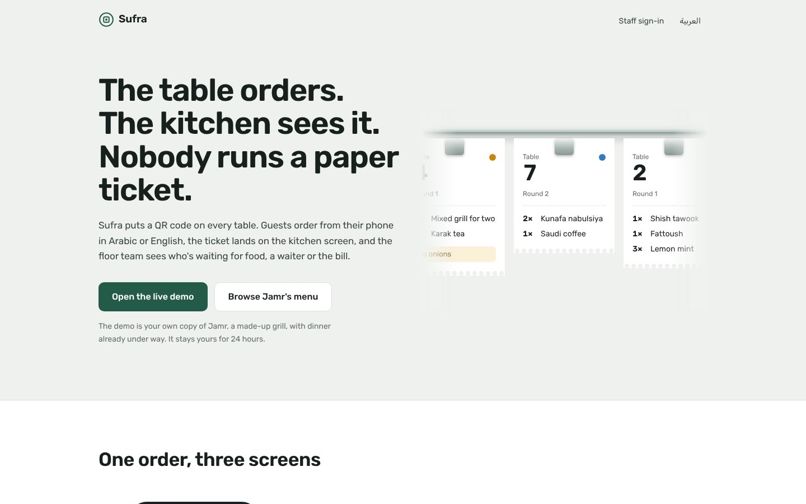
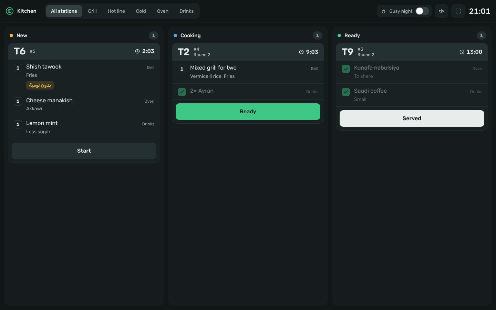
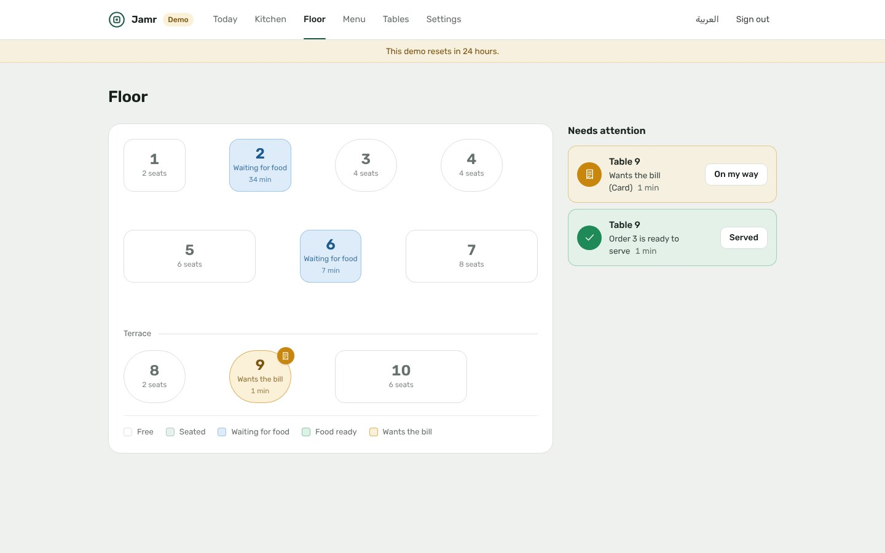

# Sufra (سفرة)

Table ordering for restaurants in the Gulf and Egypt. Guests scan the QR code on their table and order from their phone in Arabic or English; the ticket lands on the kitchen board; the floor team sees which tables are waiting for food, want a waiter, or asked for the bill and how they'll pay.

*Sufra* is the Arabic word for the spread a meal is laid out on.



**Try it:** "Open the live demo" on the home page gives you your own copy of Jamr, a made-up charcoal grill, with dinner already under way: three tables eating, one waiting for its bill. Scan table 4's code with your phone, order, and watch the ticket arrive on the kitchen board. Slide it to "ready" and your phone shows it. Ask for the bill from the phone, then close the table from the floor plan. Switch on "Busy night" and the other tables keep ordering while the board is open.

| | |
|---|---|
|  |  |

## What it does

**For guests** (no app, no account)
- The menu in Arabic or English, with categories that follow the scroll, search, photos, calories and VAT-inclusive prices, as Saudi menus must show.
- Options with rules: choose one, choose exactly two, or up to two. Price and calories update as you choose, and the kitchen gets your note.
- A cart that works out the bill: VAT included (Saudi Arabia) or service charge plus VAT added on top (Egypt).
- Each round's progress as it happens (received, cooking, ready, served), "call a waiter", and "bring the bill" with cash or card.
- Everyone at the table sees the same tab. A phone from an earlier visit doesn't see the next party's orders.

**For the kitchen**
- New, cooking and ready columns, oldest first, each ticket with a running clock that turns amber, then red (the thresholds are per restaurant).
- Station views (grill, hot line, cold, oven, drinks). Each station sees its own dishes and marks its part done; when the last station finishes, the ticket is ready.
- Tap a dish to tick it off, tap the button or slide the whole ticket to move it on, and undo for six seconds.
- An optional chime for new tickets, and full screen. It runs on a phone, a tablet or a TV.

**For the floor and the owner**
- A floor plan with each table's state and how long it has waited, plus a list of who needs a waiter or the bill, and which food is waiting at the pass.
- Closing a paid table keeps the bill total and frees the table; anything still in the kitchen is cancelled.
- Mark a dish sold out and every open menu greys it out within seconds. Names, descriptions, prices and calories can be edited.
- Printable QR tent cards for every table, and a new code for a table whose printout has gone missing.
- Today's numbers: orders, sales, average time to ready, orders by hour, the most ordered dishes.
- Staff sign in with the restaurant's code and a six-digit PIN, or put the kitchen on a tablet by scanning a one-time QR from a screen that's already signed in.

## How it's built

| | |
|---|---|
| App | Next.js 16 (App Router, Cache Components, Server Actions), React 19, TypeScript |
| Data | Postgres with Drizzle ORM in its own `sufra` schema; PGlite (Postgres in WASM) locally and in tests |
| UI | Tailwind CSS 4, Rubik for Arabic and Latin, Aref Ruqaa for the restaurant's name. No component, animation or chart library |
| QR codes | `qrcode` for the matrix, drawn as SVG on the server |
| Hosting | Vercel and Neon, both on free plans |

### Decisions worth reading

**Live screens without websockets.** Every change bumps a version number on the restaurant, in the same transaction as the change itself. Screens ask "anything newer than v?" every second or two, and the server answers `204 No Content` when nothing has changed, so an idle kitchen costs one indexed read per poll. Polling pauses while a tab is hidden, backs off when the network drops, and ignores answers older than what's on screen, so a slow poll can't undo a newer update from the screen's own action. Serverless functions don't hold sockets open; this works anywhere and is easy to reason about.

**The server decides the price.** The phone sends dish ids, option ids, quantities and notes. The server reloads the menu, checks every option rule and that each dish is still available, and works out prices and the bill itself. A dish that sold out while the guest was choosing comes back by name, so the guest can remove it and send the rest.

**An order can't be sent twice.** The phone makes a key for each version of its cart and sends it with every attempt; `orders` has a unique index on (restaurant, key). A retry after a dropped connection gets the original order back instead of a second one.

**Order numbers restart each day in the restaurant's own time zone.** The number comes from the same `UPDATE` that bumps the version, so two tables ordering at the same moment get consecutive numbers:

```sql
UPDATE sufra.restaurants SET
  order_seq = CASE WHEN order_day = to_char(now() AT TIME ZONE timezone, 'YYYY-MM-DD') THEN order_seq + 1 ELSE 1 END,
  order_day = to_char(now() AT TIME ZONE timezone, 'YYYY-MM-DD'),
  version = version + 1
WHERE id = $1 RETURNING order_seq;
```

**One open tab per table, enforced by Postgres.** A partial unique index (`sessions (table_id) WHERE closed_at IS NULL`) plus `INSERT … ON CONFLICT DO NOTHING` means two phones ordering at once share one tab. Requests work the same way: one open bill request per tab, and asking again only updates how they'll pay.

**Stations, not just tickets.** Every line on a ticket carries its station, and the ticket follows its lines: the first dish ticked off means cooking, the last one done means ready, and un-ticking a dish takes it back. Undoing "ready" reopens only the dishes that the "ready" tap closed (`done_at >= ready_at`), not the ones a cook had already finished.

**Two people tapping the same ticket.** Every move says which state the screen showed (`from`). If someone else has already moved the ticket, the update matches nothing and the screen says so, instead of skipping a step.

**Gestures that behave like objects.** Sheets and tickets follow the finger. On release they go where the flick was heading (the position plus projected momentum, at UIKit's normal deceleration rate), on springs that start from the finger's velocity, can be caught mid-flight, and stretch with resistance past an edge. It's a small spring integrator rather than an animation library, and it steps aside for reduced motion.

**A demo for every visitor, and a busy night on demand.** "Open the live demo" copies Jamr (menu, tables and a dinner service in progress) into a new restaurant that is deleted after a day. The busy-night simulator has no background worker: each poll of the kitchen board asks whether the next order is due, and a single atomic `UPDATE … WHERE sim_next_at <= now()` decides which poll places it.

**Regional details.** Saudi menus show VAT-inclusive prices and calories, with the SFDA reminder that adults need about 2,000 calories a day. Egyptian bills add a service charge, then VAT on both. Arabic counts agree with their numbers (منذ دقيقتين، منذ 3 دقائق، منذ 11 دقيقة), and guest timestamps use the restaurant's time zone.

**Signing in.** PINs are hashed with scrypt, attempts are limited per code and visitor, and staff sessions are HMAC-signed cookies. Every staff action checks that the row it touches belongs to the signed-in restaurant.

## Photographs

Jamr is fictional, and its photographs were generated for this demo. `scripts/photos.sh` (run by a GitHub Action) downloads them and writes the sizes the menu uses into `public/photos/`. Without them the menu shows a plate-on-slate placeholder instead of a broken image.

## Running it locally

```bash
npm install
npm run dev
```

Open http://localhost:3000 and start the demo. With no `DATABASE_URL`, Sufra creates an embedded Postgres in `.data/`. To order from your phone on the same Wi-Fi, open the staff pages through your computer's network address (the QR codes point at whichever address the page was opened on) or set `SUFRA_PUBLIC_URL`.

Settings are listed in [`.env.example`](.env.example).

## Tests

```bash
npm test
```

Unit tests cover money and VAT, option rules, ticket steps and Arabic wording. The flow tests run the whole service on an in-memory Postgres: a demo mid-service, ordering with server-side prices, retries that don't duplicate, sold-out dishes, kitchen moves and stations, double taps, service requests, closing a table, the simulator, device pairing and cleanup.

## Project layout

```
src/server/        guest.ts (ordering, requests), staff.ts (tickets, tables), sim.ts, demo.ts, menu.ts, auth.ts
src/lib/           money (prices, VAT, service), selection (option rules), tickets, spring (gesture physics), i18n
src/components/    guest/ (menu, sheets), kitchen/ (board, tickets), staff/ (floor, menu, settings), landing/
src/app/[lang]/    t/[token] (a table's menu), m/[slug] (menu without ordering), staff/ (kitchen, floor, …)
src/db/            migrations (SQL), schema (Drizzle), seed-data (Jamr)
test/              unit and flow tests
```

Built by [Seif Ashraf](https://seifashraf.dev).
